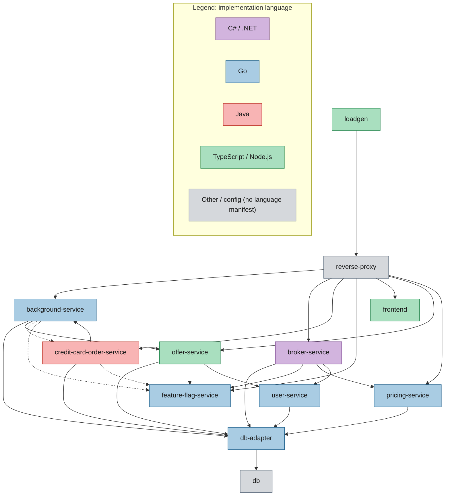

# EasyTrade

A project consisting of many small services that connect to each other.  
It is made like a stock broking application - it allows it's users to buy&sell some stocks/instruments.  
Of course it is all fake data and the price has a 24 hour cycle...

## Architecture diagram

Generated from `compose.dev.yaml` via `make update-graph` — do not edit the block below by hand.

<!-- dependency-graph:start -->

<!-- dependency-graph:end -->

- solid arrow: `depends_on` in compose
- dashed arrow: inferred from an environment variable value referencing another service
- dashed border: no entry in `compose.dev.yaml` (e.g. Kubernetes-only or build-only service)
- node color: implementation language, detected from the service's manifest file (see the "Legend" group inside the diagram)

## Service list

EasyTrade consists of the following services/components:

| Service                                                              | Proxy port | Proxy endpoint               |
| -------------------------------------------------------------------- | ---------- | ---------------------------- |
| [Background service](src/background-service/README.md)               | 80         | `/background-service`        |
| [Broker service](src/broker-service/README.md)                       | 80         | `/broker-service`            |
| [Credit card order service](src/credit-card-order-service/README.md) | 80         | `/credit-card-order-service` |
| Db                                                                   | --         | `---`                        |
| [Db adapter](src/db-adapter/README.md)                               | --         | `---`                        |
| [Feature flag service](src/feature-flag-service/README.md)           | 80         | `/feature-flag-service`      |
| [Frontend](src/frontend/README.md)                                   | 80         | `/`                          |
| [Loadgen](src/loadgen/README.md)                                     | --         | `---`                        |
| [Offer service](src/offer-service/README.md)                         | 80         | `/offer-service`             |
| [Pricing service](src/pricing-service/README.md)                     | 80         | `/pricing-service`           |
| [Reverse proxy](src/reverse-proxy/README.md)                         | 80         | `---`                        |
| [User service](src/user-service/README.md)                           | 80         | `/user-service`              |

> To learn more about a service's endpoints go to its respective readme. Every service
> also exposes `/livez`, `/readyz` and `/version`, and several ship a `.http` request
> collection next to their readme.

## Database

All persistent state lives in a single `db` service. `db-adapter` is the only component
that holds a database connection - every other service reaches it over gRPC on port
`50051` using the shared contracts in [`src/proto`](src/proto/ADAPTER_SERVICES.md).

The backend is selected by `DB_TYPE` / `DB_URL` in [`.env`](.env). **MSSQL is the
default**; Postgres is supported as an alternate backend by swapping which of the two
pairs is commented out. Schema and seed scripts for each dialect live in
`src/db/mssql/` and `src/db/postgres/`.

The [Portfolio insights](#portfolio-insights-demo-feature) feature adds an `Alerts` table,
created by `src/db/postgres/sql-scripts/13-alerts.sql` and
`src/db/mssql/sql-scripts/sql-alerts.sql`. See [`src/db/README.md`](src/db/README.md) for
the script layout of both dialects.

### Getting the `Alerts` table into an existing database

Init scripts do not add the table to an existing database. PostgreSQL runs
`/docker-entrypoint-initdb.d` only when its data directory is empty. MSSQL reruns its whole
script list on every start without stopping on errors, and each rerun duplicates the seeded
holdings. Restarting a persistent MSSQL database is therefore **not** a way to get the table.

- **Compose:** neither Compose file declares a named database volume, but the PostgreSQL
  base image keeps its data in an anonymous volume. For a fresh database run `make clean`,
  then `make start`; with the runtime `compose.yaml`, run `docker compose down --volumes`,
  then `docker compose up -d`. **This deletes the stack's data.**
- **Helm:** persistence is off by default, so a new database pod starts empty. With
  persistence enabled, `helm uninstall` leaves the StatefulSet's PVC in place, so the PVC
  must be deleted explicitly, which destroys its data. See
  [`helm/easytrade/README.md`](helm/easytrade/README.md).
- **Keeping existing data:** back up the database, then apply the dialect's script once by
  hand: `sqlcmd -I -i sql-alerts.sql` (MSSQL) or `psql -f 13-alerts.sql` (PostgreSQL). Both
  scripts are guarded (`IF OBJECT_ID(...) IS NULL` / `CREATE TABLE IF NOT EXISTS`), so a
  repeat apply is harmless.

## Docker compose

To run the easytrade using docker you can use provided `compose.yaml`.
To use it you need to have:

- Docker with minimal version **v20.10.13**
  - you can follow [this](https://docs.docker.com/engine/install/ubuntu/) guide to update Docker
  - this guide also covers installing Docker Compose Plugin
- Docker Compose Plugin
  ```bash
  sudo apt update
  sudo apt install docker-compose-plugin
  ```
  - more information in [this](https://docs.docker.com/compose/install/linux/) guide

With this you can run

```bash
docker compose up
# or to run in the background
docker compose up -d
```

You should be able to access the app at `localhost:80` or simply `localhost`.

> **NOTE:** It make take a few minutes for the app to stabilize, you may experience errors in the frontend or see missing data before that happens.

> **NOTE:** Docker Compose V1 which came as a separate binary (`docker-compose`) will not work with this version. You can check this [guide](https://www.howtogeek.com/devops/how-to-upgrade-to-docker-compose-v2/) on how to upgrade.

## Local development

The root `Makefile` wraps the compose and Helm commands you need while working on
the code. It builds images from local source (`compose.dev.yaml`) rather than
pulling them from the registry.

```bash
make help    # list every target
```

```bash
make build            # build all images from local source
make start            # start the whole stack, building anything missing
make stop             # stop the stack and remove its containers
make clean            # ...and also drop volumes and locally built images
```

Every compose target accepts an optional `services=` to narrow the scope — a single
name, or a quoted space-separated list. Omit it to act on the whole stack:

```bash
make build services=pricing-service
make start services="db reverse-proxy background-service"
```

Two targets act on exactly one service and therefore require `services=`:

```bash
make restart  services=frontend   # recreate the container, no rebuild
make redeploy services=frontend   # rebuild the image, then recreate — use after a code change
```

The dev stack publishes each service on its own host port, so you can hit a service
directly instead of going through nginx:

| Service                     | Host port                     | Container port |
| --------------------------- | ----------------------------- | -------------- |
| `reverse-proxy`             | 80                            | 80             |
| `pricing-service`           | 8083                          | 8080           |
| `broker-service`            | 8084                          | 8080           |
| `offer-service`             | 8087                          | 8080           |
| `user-service`              | 8089                          | 8080           |
| `credit-card-order-service` | 8091                          | 8080           |
| `frontend`                  | 8092                          | 3000           |
| `feature-flag-service`      | 8094                          | 8080           |
| `background-service`        | 8095                          | 8080           |
| `db-adapter`                | 50051 (gRPC), 8096 (health)   | 50051, 8080    |
| `loadgen`                   | 8097                          | 8080           |
| `db`                        | 1433 (MSSQL), 5432 (Postgres) | 1433 / 5432    |

To run the pre-built registry images through the Makefile instead, use
`make start-remote`.

## Kubernetes instructions

To deploy Easytrade in kubernetes you need to have:

- `helm`
  - install [guide](https://helm.sh/docs/intro/install/)
- `kubectl`
  - install [guide](https://kubernetes.io/docs/tasks/tools/install-kubectl-linux/)
- `kubeconfig` to access the cluster you want to deploy it on
  - more info on it [here](https://kubernetes.io/docs/concepts/configuration/organize-cluster-access-kubeconfig/)

Using the Makefile (release name and namespace both default to `easytrade`):

```bash
# create namespace and deploy easytrade from the published chart
make k8s-install-remote

# ...or from the chart in this repo, e.g. to test local chart changes
make k8s-install

# uninstall easytrade
make k8s-uninstall
```

Both install targets are idempotent (`helm upgrade --install`), so re-running one
upgrades an existing release. Override the defaults per invocation:

```bash
make k8s-install HELM_RELEASE=easytrade-test HELM_NAMESPACE=easytrade-test
```

The equivalent raw commands:

```bash
# create namespace and deploy easytrade
helm install easytrade oci://europe-docker.pkg.dev/dynatrace-demoability/helm/easytrade --create-namespace --namespace easytrade

# uninstall easytrade
helm uninstall easytrade -n easytrade

# delete namespace
kubectl delete namespace easytrade
```

## Where to start

After starting easyTrade application you can:

- go to the frontend and try it out. Just go to the machines IP address, or "localhost" and you should see the login page. You can either create a new user, or use the existing "james_norton/pass_james_123" user (see below). Remember that in order to buy stocks you need money, so visit the deposit page first.
- browse a service's API - each service readme documents its endpoints, and several ship a `.http` request collection you can run straight from your editor.
- after some time go to dynatrace to configure your application and see what is going on in easyTrade - to have it work you will need an agent on the machine where you started easyTrade :P

## EasyTrade users

If you want to use easyTrade, then you will need a user. You can either:

- use the existing user - he has some preinserted data and new data is being generated from time to time:

  - login: james_norton
  - pass: pass_james_123

- create a new user - click on "Sign up" on the login page and create a new user.

> **NOTE:** After creating a new user there is no confirmation given, no email sent and you are not redirected... Just go back to login page and try to login. It should work :)

## Problem patterns

Currently there are 4 problem patterns supported in easyTrade (the feature flag service
exposes 9 flags in total - the remaining ones gate frontend flag management, credit card
meltdown, credit card memory leak and credit card validation, plus the
`portfolio-insights-enabled` feature flag, tagged `feature` rather than a problem pattern,
described in [Portfolio insights](#portfolio-insights-demo-feature)):

1. DbNotResponding - after turning it on no new trades can be created as the database will throw an error. This problem pattern is kind of proof on concept that problem patterns work. Running it for around 20 minutes should generate a problem in dynatrace.

2. ErgoAggregatorSlowdown - after turning it on 2 of the aggregators will start receiving slower responses which will make them stop sending requests after some time. A potential run could take:

   - 15 min - then we will notice a small slowdown (for 150 seconds) followed by 40% lower traffic for 15 minutes on some requests
   - 20 min - then we will notice a small slowdown (for 150 seconds) followed by 40% lower traffic for 30 minutes on some requests

3. FactoryCrisis - when enabled, the factory won't produce new cards, which will cause background-service's manufacture scheduler not to process credit card orders. This will block the Credit Card Order service.

4. HighCpuUsage - this problem pattern causes a slowdown of broker-service response time and highly increases CPU usage during that time. If the app is deployed on K8s, a CPU resource limit is also applied by background-service's operator subsystem. This should generate CPU throttling on the pod.

The API identifies each pattern by a snake_case flag id, not by the name used above.
Note there is no trailing slash - the router redirects `/v1/flags/{id}/` and the redirect
drops the request body, so the toggle silently does nothing.

| Problem pattern         | Flag id                    |
| ----------------------- | -------------------------- |
| DbNotResponding         | `db_not_responding`        |
| ErgoAggregatorSlowdown  | `ergo_aggregator_slowdown` |
| FactoryCrisis           | `factory_crisis`           |
| HighCpuUsage            | `high_cpu_usage`           |

To turn a pattern on/off send a request similar to the following:

```sh
curl -X PUT "http://{IP_ADDRESS}/feature-flag-service/v1/flags/{FLAG_ID}" \
-H  "accept: application/json" \
-d '{"enabled": {VALUE}}'
```

You can also manage enabled problem patterns via the easyTrade frontend.

> **NOTE:** More information on the feature flag service's parameters available in [feature flag service's doc](src/feature-flag-service/README.md).

## Portfolio insights (demo feature)

An optional **Portfolio Insights** page shows an account's portfolio value, invested amount,
unrealized profit/loss (P/L), allocation per instrument, largest position and a `LOW` /
`MEDIUM` / `HIGH` concentration-risk badge. It also offers target-price and profit/loss
alerts with in-app notifications. Everything it shows is
**simulated demo data and not financial advice**: prices come from the existing generated
candles, and notifications are in-app Toasts only (no email or SMS). The feature is off by
default, and with it off the application behaves exactly as before.

### Feature flag

- Id `portfolio-insights-enabled`, tag `feature`. Unlike the snake_case problem-pattern ids,
  it is hyphenated. **Disabled by default.**
- Startup default: `ENABLE_PORTFOLIO_INSIGHTS` on `feature-flag-service`. Flag state lives
  in memory, so a restart restores the configured startup default: `false` as shipped,
  `true` where `ENABLE_PORTFOLIO_INSIGHTS=true` is set.
- Runtime toggle, again with no trailing slash:

  ```sh
  curl -X PUT "http://{IP_ADDRESS}/feature-flag-service/v1/flags/portfolio-insights-enabled" \
  -H "accept: application/json" \
  -d '{"enabled": true}'
  ```

- A deployment with `ENABLE_MODIFY=false` locks every flag, this one included. Its state
  then comes only from `ENABLE_PORTFOLIO_INSIGHTS` at startup.
- The flag is **not** listed on the frontend `/feature-flags` page, which shows only
  `problem_pattern` flags. Toggle it through the API.

When a toggle takes effect:

| Consumer                 | Sees the change                                                                     |
| ------------------------ | ----------------------------------------------------------------------------------- |
| broker-service endpoints | On the next request - the flag is read fresh on every request, with a 2 s deadline  |
| Alert evaluation         | At the start of its next cycle                                                      |
| Visible browser tab      | Within 15 s plus the 2 s read; at once on window focus or reconnect, and on any 403 |
| loadgen                  | At the next visit start                                                             |

While the flag is off, or `feature-flag-service` is unreachable, the feature fails closed:

- every new endpoint answers HTTP 403 with `{"error":"feature_disabled"}`;
- the navigation link is hidden, and `/insights` redirects to `/home`;
- alert evaluation does nothing.

### Endpoints

The seven endpoints belong to broker-service and are reached through the reverse proxy
under `/broker-service`, for example `http://{IP_ADDRESS}/broker-service/v1/alerts`.

| Method and path                                               | Purpose                                                                            |
| ------------------------------------------------------------- | ---------------------------------------------------------------------------------- |
| `GET /v1/portfolio/insights/{accountId}`                      | Portfolio figures, allocations, largest position and risk level                    |
| `POST /v1/alerts`                                             | Create an alert from `accountId`, `type`, `instrumentId`, `direction`, `threshold` |
| `GET /v1/alerts?accountId=`                                   | List the account's alerts, newest first                                            |
| `PATCH /v1/alerts/{id}`                                       | Enable or disable an alert with `{"enabled": bool}`; `true` re-arms it             |
| `DELETE /v1/alerts/{id}`                                      | Delete an alert together with its notification                                     |
| `GET /v1/alerts/notifications?accountId=&unacknowledged=true` | List triggered alerts; `unacknowledged=true` keeps only unacknowledged ones        |
| `POST /v1/alerts/{id}/acknowledge`                            | Acknowledge the notification of the alert's current arming                         |

Alert types are `TARGET_PRICE` (the threshold is a price) and `PROFIT_LOSS` (the threshold
is the holding's P/L percentage), and directions are `ABOVE` and `BELOW`. An alert triggers
only when the value strictly crosses its threshold, and each arming of an alert notifies
exactly once; re-arming starts a new arming. See
[`src/broker-service/README.md`](src/broker-service/README.md#portfolio-insights-and-alerts)
for statuses, error bodies and the `{"results": [...]}` list envelope, and
[`broker-service.http`](src/broker-service/broker-service.http) for runnable requests.

### Configuration

| Variable                            | Service                | Default | Meaning                                                                                          |
| ----------------------------------- | ---------------------- | ------- | ------------------------------------------------------------------------------------------------ |
| `ENABLE_PORTFOLIO_INSIGHTS`         | `feature-flag-service` | `false` | Startup value of the flag                                                                        |
| `ALERT_EVALUATION_INTERVAL_SECONDS` | `broker-service`       | `60`    | Seconds between alert evaluation cycles; values outside 1–4294967 fall back to 60 with a warning |
| `PORTFOLIO_INSIGHTS_ALERT_WEIGHT`   | `loadgen`              | `0`     | Weight of the opt-in `portfolio_insights_alert` visit; 0 keeps today's workload                  |

All three are declared in `compose.yaml`, `compose.dev.yaml` and
`helm/easytrade/values.yaml`, with these defaults. For a demo setup with no file edit:

```bash
# Compose: set both values for this start, or put the same two lines in .env
ENABLE_PORTFOLIO_INSIGHTS=true PORTFOLIO_INSIGHTS_ALERT_WEIGHT=1 make start

# Helm
helm upgrade --install easytrade helm/easytrade --namespace easytrade --create-namespace \
--set feature-flag-service.env.ENABLE_PORTFOLIO_INSIGHTS="true" \
--set loadgen.env.PORTFOLIO_INSIGHTS_ALERT_WEIGHT="1"
```

More detail in [`src/feature-flag-service/README.md`](src/feature-flag-service/README.md),
[`src/loadgen/README.md`](src/loadgen/README.md) and
[`helm/easytrade/README.md`](helm/easytrade/README.md).

### Database schema

An existing database does not get the `Alerts` table by itself; see
[Getting the `Alerts` table into an existing database](#getting-the-alerts-table-into-an-existing-database)
in [Database](#database).

### Walkthrough

1. Enable the flag: start with `ENABLE_PORTFOLIO_INSIGHTS=true make start`, or, on a running
   stack, send the `PUT` above with `{"enabled": true}`. The broker applies the change on its
   next request, and a visible tab within 15 s plus the 2 s read deadline, at once on focus.
   A restart restores the startup default, and an `ENABLE_MODIFY=false` deployment cannot
   toggle it.
2. Log in (for example `james_norton` / `pass_james_123`), deposit, and buy an instrument.
3. Open **Portfolio Insights** in the sidebar. Read the figures and the risk badge.
4. Read the instrument's current price. Before waiting, create two target-price alerts on
   it: `ABOVE` with a threshold just below the price, and `BELOW` with a threshold just above
   it. Whichever way the next price moves, one of the two is crossed.
5. Within two evaluation cycles (`ALERT_EVALUATION_INTERVAL_SECONDS`, 60 s by default), a
   Toast and a notification appear for at least one of them.
6. Acknowledge the notification. Re-arm an alert with its "Re-arm" or "Enable" button to
   receive a new notification on its next crossing.

> **NOTE:** Cost basis is not stored; it is derived from the account's retained executed
> trades. Quantity older than that history, such as seeded holdings, is valued at the
> latest price and therefore shows near-zero P/L.

## EasyTrade on Dynatrace - how to configure

All Dynatrace configuration required for Easytrade should be applied using [Monaco](https://github.com/Dynatrace/dynatrace-configuration-as-code). More information on how to deploy it can be found in the [`monaco` directory](./monaco).

### Business events in Dynatrace

EasyTrade application has been developed in order to showcase business events. Usually business events can be created in two ways:

- directly - using one of Dynatrace SDKs in the code - so for example in Javascript or Java
- indirectly - configure catch rules for request that are monitored by Dynatrace

If you want to learn more about business events then we suggest looking at the information on our website: [Business event capture](https://www.dynatrace.com/support/help/platform-modules/business-analytics/ba-events-capturing). There you will find information on how to create events directly (with OpenKit, Javascript, Android and more) and indirectly with capture rules in Dynatrace.

For those interested in creating capturing rules for easyTrade we suggest to have a look at the configuration exported with Monaco in this repository. Have a look at the [README](./monaco/README.md)

The [Portfolio insights](#portfolio-insights-demo-feature) feature adds two business events.
The frontend sends them directly through its existing business-event helper, so no Monaco
capture rule is needed:

- `com.easytrade.portfolio-insights.view` - once per successful page load, with
  `accountId`, `holdingCount` and `riskLevel`.
- `com.easytrade.alert.create` - after a successful create (201), with `accountId`,
  `alertId`, `type`, `instrumentId`, `direction` and `threshold`.

## Body types

EasyTrade network traffic is handled by REST requests using mostly JSON payloads. However, some of the services
can also handle XML requests. Data types are negotiated based on `Accept` and `Content-Type` headers.

#### XML compatible services

| Service                                                           | Accepted XML MIME types                            |
| ----------------------------------------------------------------- | -------------------------------------------------- |
| [CreditCardOrderService](src/credit-card-order-service/README.md) | `application/xml`                                  |
| [OfferService](src/offer-service/README.md)                       | `application/xml`; `text/xml`                      |
| [PricingService](src/pricing-service/README.md)                   | `application/xml`                                  |

## Local Dynatrace MCP Server

This repository comes with the [local Dynatrace MCP Server](https://github.com/dynatrace-oss/dynatrace-mcp) pre-configured for VSCode. You can read more about [MCP Servers on VSCode](https://code.visualstudio.com/docs/copilot/customization/mcp-servers).
In order to try it out, you need access to the [Dynatrace Playground Environment](https://docs.dynatrace.com/docs/discover-dynatrace#playground), as well as access to [GitHub Copilot](https://github.com/features/copilot).

If everything is setup, please open **Copilot Chat** in VSCode, switch to **Agent mode**, and ask questions like 

> Which environment am I connected to?

> Are there any problems with my components on Dynatrace?

> Are there any security vulnerabilities for my component?
