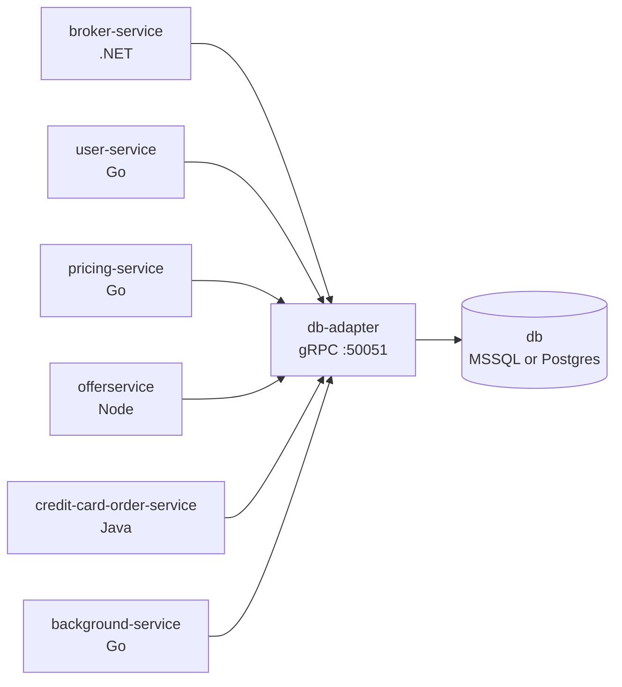

# Data layer

Every EasyTrade service shares one logical database, and exactly one service is allowed
to open a connection to it: **`db-adapter`**. Everything else goes through gRPC.



## What the adapter owns

SQL dialect, connection retry, UUID handling, and identifier quoting all live in this
one Go service. Every other service gets the same stack-independent gRPC contract
regardless of which backend is running.

The adapter also owns the `AlertService` gRPC service and the `Alerts` table behind the
Portfolio Insights alerts. The contract is `src/proto/alert_service.proto` (package
`easytrade.dbadapter.alert`), and its consumer is broker-service. Its RPCs are
`CreateAlert`, `ListAlerts`, `GetAlert`, `UpdateAlertEnabled`, `DeleteAlert`,
`TriggerAlert` and `AcknowledgeAlert`. Table and column names are identical on both
dialects. Decimals (`Threshold`, `TriggerValue`) cross gRPC as strings, never as
`double`. The adapter stamps `CreatedAt` and `TriggeredAt` from its own UTC clock, and no
request carries a timestamp.

`TriggerAlert` is the only writer of a non-null `TriggeredAt`. It is one statement, run
by the same GORM code on PostgreSQL and SQL Server, with every value bound as a
parameter, booleans included:

```sql
UPDATE "Alerts" SET "TriggeredAt" = ?, "TriggerValue" = ?, "Acknowledged" = ?
WHERE "Id" = ? AND "ArmingRevision" = ? AND "Enabled" = ? AND "TriggeredAt" IS NULL
```

One affected row means the alert triggered (`triggered = true`). Zero rows is not an
error: another evaluator won, or the alert was disabled, deleted or re-armed meanwhile.
Re-arming (`PATCH {"enabled": true}` → `UpdateAlertEnabled`) clears `TriggeredAt`,
`TriggerValue` and `Acknowledged` and increments `ArmingRevision` in one statement, so an
evaluator still holding the old revision cannot trigger. Each arming therefore yields
exactly one notification, even with concurrent evaluators: under READ COMMITTED, a second
statement waits for the first's row lock, re-checks the predicate and affects zero rows,
on PostgreSQL and on SQL Server.

### Recreating the database for alerts

A fresh database gets the `Alerts` table from its init scripts; an existing database does
not, and needs one of the procedures below.

- **Fresh databases:** PostgreSQL runs `src/db/postgres/sql-scripts/13-alerts.sql`, which
  sorts after `12-creditcards.sql`. MSSQL's `run-initialization.sh` runs
  `src/db/mssql/sql-scripts/sql-alerts.sql` last, after `sql-creditcards.sql`.
- **Existing databases:** PostgreSQL runs `/docker-entrypoint-initdb.d` only when its
  data directory is empty. MSSQL reruns its whole script list on every start without
  stopping on errors: the fixed-key account inserts then fail as key violations, and the
  holdings seed inserts duplicate rows. Restarting a persistent MSSQL database is
  therefore **not** a way to get the table.
- **Compose:** run `make clean`, which runs `down --volumes` and so removes the
  database's anonymous volume, then `make start`. **This deletes the stack's data.** Once
  the PostgreSQL `db` container has been recreated (for example by
  `make restart services=db`), that volume survives `make clean` as a dangling volume, so
  record its name first and remove it afterwards (if you did not record it,
  `docker volume ls -f dangling=true` lists the candidates; see
  [`src/db/README.md`](../../src/db/README.md#compose)):

  ```sh
  vol=$(docker inspect --format '{{range .Mounts}}{{.Name}}{{end}}' \
    "$(docker compose -f compose.dev.yaml ps -aq db)")
  make clean
  docker volume rm "$vol"
  ```

- **Helm:** persistence is off by default, so a new database pod starts empty. With
  persistence enabled, `helm uninstall` keeps the StatefulSet's PVC; delete that PVC
  explicitly, which destroys its data.
- **Keeping data:** back up first, then apply the dialect's script once by hand:
  `sqlcmd -I -i sql-alerts.sql` (MSSQL) or `psql -f 13-alerts.sql` (PostgreSQL). Both
  scripts are guarded (`IF OBJECT_ID(N'dbo.Alerts', N'U') IS NULL` /
  `CREATE TABLE IF NOT EXISTS`), so applying one again is harmless.

See [Portfolio insights (demo feature)](../../README.md#portfolio-insights-demo-feature) for the endpoints, flag, variables and walkthrough.

## Pluggable backends

`DB_TYPE` selects which backend `db-adapter` instantiates. Two ship today:

| `DB_TYPE` | Port | Schema + seed |
|---|---|---|
| `postgres` | 5432 | `src/db/postgres/` |
| `mssql` | 1433 | `src/db/mssql/` |

Any other database that GORM has a driver for can be added without touching any other
service — the rest of the stack only ever sees the gRPC contract.
